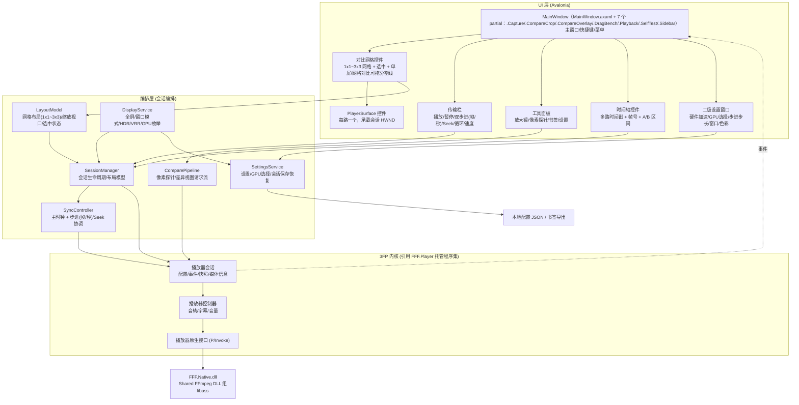
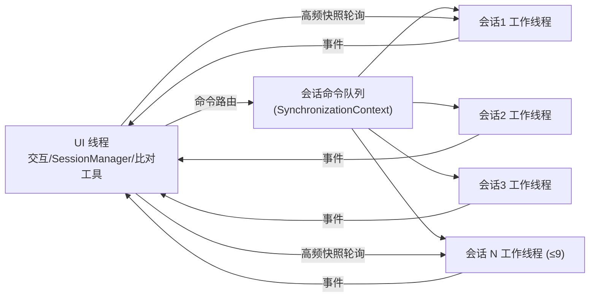

# 02 系统架构

<div align="center">

[**English**](02-系统架构.en.md) · **简体中文**

</div>

## 1. 总体分层

采用 **Avalonia 12 + .NET 11** 单进程架构（`src/3FCompare/3FCompare.csproj:28-30` 引 Avalonia/Avalonia.Desktop/Avalonia.Themes.Fluent 12.1.1，`:5` 为 `net11.0-windows`；
`src/3FCompare/App.axaml.cs:1,11` 的 `AppEntry : Application` 是应用入口；WinForms→Avalonia 迁移已于 2026-08-22 全量完成，
见 `docs/07-Avalonia迁移规划.zh.md:9` 「状态：迁移完成（M0–M5 全部通过）」，WinForms 版归档于 tag `winforms-final`）；
多路播放依靠 **多个 3FP `播放器会话` 实例** 各自持有
HWND 输出（D3D11 flip-model 交换链），由 **会话编排层** 统一调度。



## 2. 进程/线程模型

- **UI 线程**：Avalonia 的 UI 线程与消息循环（`Dispatcher.UIThread`），处理所有交互与导航。
  ⚠ 原文写"WinForms 消息循环"，与已完成的迁移不符（`docs/07-Avalonia迁移规划.zh.md:9`；主窗是 `Avalonia.Controls.Window`，见 `src/3FCompare/MainWindow.axaml.cs:30`）。
- **3FP 语义**：
  - 每个 `播放器会话` 在 Native 侧有**独立播放工作线程**（解码、呈现、时钟）；
  - 低频事件回投 UI 线程的机制**不是** `播放器配置.事件同步上下文`：当前树里 `SynchronizationContext` 在 `src/3FCompare`、`src/3FCompare.Core`
    **零命中**（2026-10-03 grep；该 API 只出现在内核侧文档 `3fp/kernel/FFF.Player/README.md`），实际约定是**一律经 `Dispatcher.UIThread.Post` 非阻塞投递**
    （该约定与"不得用 `Invoke` 同步回程"的死锁论证见 `src/3FCompare.Core/Sync/SyncController.cs:822-823`，用例见 `src/3FCompare/Controls/TimelineView.cs:62`、
    `src/3FCompare/MainWindow.CompareCrop.cs:754`）；引擎回调本身在原生线程上直接触发（`src/3FCompare.Core/Backend/Fff3FpEngine.cs:215,240`）。
  - 高频轮询走 `当前快照`/`读取音频峰值` 等无锁读取，不阻塞 WASAPI/"不访问设备对象"；轮询由 `DispatcherTimer` 驱动
    （`src/3FCompare/MainWindow.Playback.cs:190,378-381`）。
- **编排层**：所有触发播放器命令的动作都必须**经 UI 线程串行化**（同一投递通道，即上面的 `Dispatcher.UIThread.Post`），
  避免多线程同时向 Native 会话发命令引发竞态。SyncController 的"节拍器"可用
  `PrecisionTimer`/`System.Threading.Timer` 触发，但命令投递统一 Post 回 UI 上下文（"定时器选型未复核"，本条只更正串行化的载体）。



## 3. 模块职责

| 模块 | 职责 | 关键类型（建议） |
| --- | --- | --- |
| `3FCompare.App` | 入口、DI/组合根、主窗体装配 | `Program.Main` + `BuildAvaloniaApp().StartWithClassicDesktopLifetime`（`src/3FCompare/Program.cs:11,208,283`）、`AppEntry : Application`（`src/3FCompare/App.axaml.cs:11`）、`MainWindow`。⚠ 无 `AppShell` 类型（2026-10-03 grep 零命中），迁移后的对应物就是 `AppEntry` |
| `3FCompare.Core.Backend` | 后端抽象（`IPlayerEngine` 等）+ 3FP 适配器 `Backend.3FP`；**硬件解码开关/GPU 指定（逐个会话）** | `IPlayerEngine`, `EngineSession`, `EngineMediaInfo`, `AdapterSelection`（GPU 枚举/选择） |
| `3FCompare.Core.Sync` | 同步模型：主时钟、帧/秒双步进、偏移 | `SyncController`, `FrameReference`, `StepProfile`（帧步长/秒步长）, `OffsetCorrector` |
| `3FCompare.Core.Compare` | 像素探针、差异摄取、书签 | `PixelProbe`, `DiffCollector`, `BookmarkStore` |
| `3FCompare.Core.Display` | **显示/ACM/VRR/全屏模式能力探测与管理**（HDR 可用性、位深、色域、交换链参数、窗口 DWM 属性、全屏切换） | `DisplayCapabilities`, `WindowPresentation`, `FullscreenController`（详见 4.4） |
| `3FCompare.Core.Settings` | 设置与会话快照的加载/保存；**二级设置窗口数据模型** | `SettingsStore`, `SessionSnapshot`, `AppSettings`（含步进步长/GPU/窗口模式） |
| `3FCompare.UI.Controls` | 自绘控件：对比网格、PlayerSurface、时间轴、传输栏 | `CompareGridView`, `PlayerSurface`（详见下文）, `TransportBar`（含双步进按钮）, `TimelineView` |
| `3FCompare.UI.Tools` | 放大镜、像素探针面板、单屏 | `MagnifierOverlay`, `ProbePanel`（⚠ A-B 滑块视图 `AbSliderView` 已于 v0.3.1 撤除：它只画渐变占位、真机模式下会整块盖住真实画面） |
| `3FCompare.UI.Settings` | **二级设置对话框**（硬件/GPU/步进/窗口/色彩/布局） | `SettingsDialog`, `HardwarePage`, `SteppingPage`, `WindowPage` |

## 4. 关键控件设计与渲染路径

### 4.1 PlayerSurface（每路一个）

- 继承 **`NativeControlHost`**（`src/3FCompare/Controls/PlayerSurface.cs:20`），在 `CreateNativeControlCore`（`:196`）里用 `CreateWindowExW`
  自建子窗口并子类化其 WndProc（`:201,218`），最后以 `new PlatformHandle(_hwnd, "HWND")`（`:241`）交回 Avalonia；销毁走 `DestroyNativeControlCore`（`:244`）。
  ⚠ 原文写"继承 `Control`，在 `CreateControl`/`HandleCreated` 时创建子窗口"是 WinForms 时代的说法，已按上面的 Avalonia 版本更正。
  3FP 侧的接法是把该 HWND 作为会话的 `输出窗口`（`src/3FCompare/Services/PlaybackCoordinator.cs:672` → `EngineSessionOptions.OutputWindow`，
  见 `src/3FCompare.Core/Backend/Fff3FpEngine.cs:38`）。
- 3FP 的 D3D11 渲染直接输出到此 HWND（flip-model 交换链），**没有第三方插足**。
- 注意（源自 3FP README）：
  - 同一窗口上**不得并存两个 flip-model 链** → 每路 Surface 必须是独立原生窗口，禁止在内部再嵌另一个 3FP 窗口；
  - 窗口 resize / 移动显示器后需**再次调用 `设置输出窗口`**，且旧交换链与其窗口必须解绑后才能另开；
  - 切换媒体导致 SDR↔HDR 交换链切换时，3FP 会自动重配；我们只需保证 HWND 生命周期合法。

### 4.2 对比网格（CompareGridView）

- 负责 **1x1 ~ 3x3** 布局（1/2/3/4/6/9 路）：`CompareGridView : Control`（`src/3FCompare/Controls/CompareGridView.cs:95`）自绘布局，
  把 N 个 `PlayerSurface` 作为 `VisualChildren` 增删（`:190,199`），排布在 `MeasureOverride`/`ArrangeOverride`（`:384,424`）里完成；格↔路的几何来自 Core 的
  `GridPartition.ComputeCells()`（`src/3FCompare.Core/Display/GridPartition.cs:187`）。⚠ 原文的 `TableLayoutPanel` 是 WinForms 时代的描述，当前树里没有该类型（2026-10-03 grep）。
- 维护"选中路"状态（点击高亮边框）；
- 布局切换时仅调整 Surface 的位置/大小并**回调 SessionManager 更新输出窗口尺寸**；
- 缩放/平移（F15）通过 `LayoutModel.Viewport` 驱动各 Surface 的裁剪矩形：
  方案：UI 层不缩放 D3D 输出（避免二次采样），而是给各会话发"视口矩形"（0..1 归一化）由 3FP 以 1:1/Lanczos 输出子区域——需要核对 3FP 是否暴露视口设置（目前 API 未见显式视口参数，见 06 风险：视口裁剪能力待确认），
  兜底方案：UI 层 `DrawImage` 对回读缓冲采样缩放。

### 4.3 工具层与渲染叠加

- 放大镜/探针标注/**分割线与手柄**（`LayoutOverlayWindow`）等 **叠加 UI** 使用自绘在 Surface 之上的独立顶层窗口（airspace 所迫：子 HWND 永远盖在 Avalonia 绘制之上），
  不影响 3FP 的 D3D 呈现线程（3FP README 明确禁止多个线程直接提交交换链，我们会避免任何 D3D 干预）。
- 像素探针读取完全走 `ReadVideoPixel`（1x1 回读），不截屏。
- **覆盖层色彩契约**：覆盖层为 UI 侧合成，与 D3D 视频缓冲（颜色管理前）属于不同语义空间；
  在 ACM/HDR 窗口上不参与视频帧的 HDR 计量，不写入 HDR 元数据（SDR 文本/图形按系统处理），
  避免覆盖层干扰 VRR/色彩判定。

### 4.4 显示 / ACM / VRR（新增模块）

**目标**：探测并在创建会话/窗口时把显示能力、色彩空间、VRR 相关的约束落到 3FP 配置与窗口属性上。

- `DisplayCapabilities`：用 DXGI 枚举适配器/输出（`DXGI_OUTPUT_DESC`、桌面坐标、旋转、色彩空间支持、
  HDR 元数据 `DXGI_COLOR_SPACE_*`），判断该会话所在显示器是否启用 Advanced Color / HDR / 位深；
  与 3FP 的 `色彩模式变化`事件 + 快照.实际色彩模式 联动做降级提示。
- `WindowPresentation`：负责把**会话 HWND 与 3FP 输出窗口绑定**，并在以下时机重新评估：
  - 窗口跨屏移动 / 显示器拔插（重新探测目标显示器能力，必要时触发 3FP 色彩模式变更）；
  - DPI 变化（若只涉及缩放，3FP 适配器内部重设输出窗口即可）。
- VRR：
  - 播放窗口为独立顶层窗口；**不主动设置固定刷新率 / 不锁定 Present 节奏**（除非 3FP 提供 AdaptSync/VRR API，见 03 A9）；
  - 若 3FP 暴露 Present 节奏/目标帧率参数，则把「跟随媒体帧率」的可选项透传给用户（F27）；
  - 全屏/无边框切换时复用 DWM 全屏优化（`DXGI_SWAP_CHAIN_FLAG_ALLOW_TEARING` 由 3FP 内部处理与否需确认，见 A8）。
- **探针/读色彩一致性**：多会话都读「颜色管理前」原生缓冲，保证跨路对比不被 DWM 后处理污染；HDR 与 SDR 混播时统一到同一 `色彩模式` 再对比。

### 4.5 二级设置窗口（SettingsDialog）

- 独立模态对话框（`F25`），由主窗口菜单/工具栏打开；
- 页面划分：
  - **硬件页**：硬件解码总开关、每路可选 GPU（`AdapterSelection` 枚举系统适配器，列出名称/显存/解码能力）、硬件渲染开关；
  - **步进页**：按帧步长（默认 1 帧，可调 ±N）、按秒步长（默认 1 秒，可调 ±N）、步进键位；
  - **窗口页**：默认启动模式（窗口/全屏）、全屏时隐藏哪些 UI、窗口尺寸记忆；
  - **解码/色彩页**：CPU/GPU 解码、色彩模式（SDR/HDR/ACM）、音轨；
  - **布局页**：默认网格行列、每路独立解码配置；
  - **其他**：快捷键方案、探针偏好、VRR 呈现选项（若 A8/A9 支持）。
- 改动即时或「应用时重启会话」两种策略（由各页标注）：硬件页改动需重建受影响会话；步进/窗口页即时生效。
- 设置持久化走 `SettingsStore`（JSON），遵守 NativeAOT 序列化限制（见 06 R15）。

### 4.6 全屏 / 窗口模式（FullscreenController）

- **窗口模式**：普通 `Avalonia.Controls.Window`（`src/3FCompare/MainWindow.axaml.cs:30` 声明 `partial class MainWindow : Window`），可 resize/最大化（几何持久化见 `:3219-3220` 恢复 `WindowState.Maximized`）；
  ⚠ 原文"普通 WinForms 窗体"已按现状更正；
- **全屏模式**：`WindowState = WindowState.FullScreen`（`src/3FCompare/MainWindow.axaml.cs:2870`，由 `_fullscreen` 开关在 Normal/FullScreen 间切），隐藏时间轴/工具栏，仅保留网格与必要覆盖层；
- 全屏切换需处理：输出窗口重设尺寸（3FP `设置输出窗口`）、DWM 全屏优化生效（VRR 相关）、
  Surface 布局重排、ESC/热键退出；
- 全屏下多路网格仍保持 1x1~3x3 布局，选中路可临时放大为单格。

## 5. 事件流

```mermaid
sequenceDiagram
    participant UI as UI线程
    participant SM as SessionManager
    participant P as 播放器会话
    participant N as FFF.Native

    UI->>SM: 打开视频(A.mp4)
    SM->>P: 创建会话(输出窗口=Surface.HWND, 事件同步上下文=UI)
    P->>N: FFF3FP_Create / FFF3FP_Open
    N-->>P: 打开完成事件