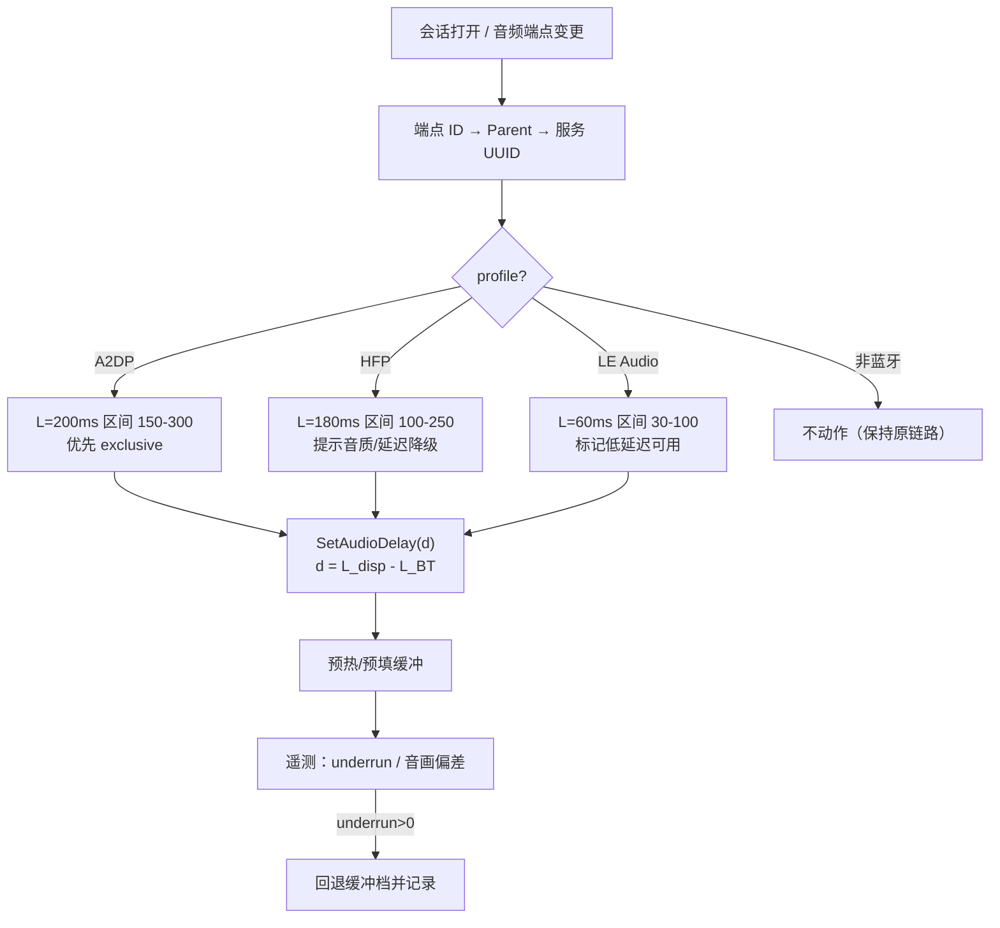

# 86 蓝牙音频延迟量化与"预播放"开关 — 可行性分析

<div align="center">

**简体中文** · 2026-11-14 · 3FCompare / 3FP 音频链路

</div>

## 0. 结论（先看这五条）

1. **蓝牙音频延迟不是协议常数，而是"协议类别 + 接收端缓冲策略"的稳定区间。**
   可以量化到类别级（A2DP 150–300 ms、HFP 100–250 ms、LE Audio 30–100 ms），
   不能量化到"这台设备此刻就是 187 ms"——除非做一次实测校准。

2. **Windows 能可靠识别"当前握手的是哪个 profile"，但读不到 codec。**
   音频端点 → ContainerID → `BTHENUM\<服务UUID>` 这条链是确定的
   （`110B`=A2DP、`111E/1112`=HFP、`BthLEAudio`=LE Audio，见 §3 本机实测）。
   SBC/AAC/aptX/LC3 的选择结果没有公开 API，也没有注册表属性。

3. **Windows 不消费 AVDTP Delay Reporting。** 耳机按规范会把自身缓冲延迟上报，
   但 Microsoft 蓝牙栈不把它交给应用层——所以"向系统要一个准确延迟值"这条路是死的。

4. **"预播放"不降低链路延迟，它只做两件事：消掉起播/重连空窗、把音画对齐。**
   真正贵的是蓝牙链路本身（A2DP 150–300 ms），不是本项目的音频池：
   默认储备目标 `AudioInitial()` = **60 ms**，端点缓冲 **30–50 ms**。
   上一版把 `REFERENCE_TIME`/`*100ns` 当成毫秒，读成了 600 ms/300–500 ms，是 10 倍误差。
   压延迟优先 exclusive（端点 ~10 ms）与 LE Audio；池子最多再省 ~30 ms，不是主项。

5. **可行，而且内核能力已经齐了。** `FFF3FP_SetAudioEndpoint` / `SetAudioExclusiveMode` /
   `SetAudioDelay` 三个入口都已存在（`FFF.Player.Api.h:1125/1129/984`），
   托管层一个都没接。开关的主要工作是"探测 + 策略 + 托管接线 + UI"，不是重写音频栈。

---

## 1. 延迟到底是什么：六段拆分

端到端延迟（按键→耳朵听到）可以拆成：

```
L_total = L_host + L_encode + L_link + L_sink_jitter + L_sink_dsp (+ L_tws)
```

| 段 | 典型值 | 由谁决定 | 备注 |
| --- | --- | --- | --- |
| `L_host` 主机缓冲 | 10–30 ms（正常应用）；**本项目默认 60 ms 储备** | 应用/系统音频引擎 | 含 30–50 ms 端点缓冲；见 §6.1 |
| `L_encode` 编码成帧 | SBC 5–20；AAC 20–45；aptX 2–10；LC3 7.5/10 | codec 帧长 + 编码器 lookahead | 帧长是硬下限 |
| `L_link` 组包/重传/空口 | 5–30 ms | 蓝牙控制器、重传策略 | 干扰下变长 |
| `L_sink_jitter` 接收端抖动缓冲 | **40–200 ms** | 耳机固件（黑盒） | 最大不确定性；"游戏模式"就是压它 |
| `L_sink_dsp` 耳机 DSP | 5–30 ms | ANC/EQ/上混 | 通常不计入上报值 |
| `L_tws` 双耳同步 | 经典 10–40；LE Audio ≈0 | 耳机私有方案 | LE Audio 靠 CIS 天然同步 |

**"固定"的正确理解**：稳态下同一设备、同一 codec、同一距离，这个值可重复到 ±10–20 ms；
换耳机、换 codec、开麦克风、进干扰环境都会变。所以它是"分段稳定的区间"，不是物理常数。

---

## 2. 按协议量化：Windows 视角的对照表

### 2.1 Windows 实际支持的 A2DP codec

Microsoft 官方文档给出的选择顺序是
**aptX Adaptive（24H2，仅 Qualcomm  radio）→ AAC（Win11 21H2）→ aptX Classic（Win10 1507）→ SBC**，
取主机与耳机都支持的第一个。LDAC **不在** Microsoft 栈里；aptX LL 也不在。

> 实践含义：在普通 Intel/MediaTek 机器上，Windows 上的 A2DP 绝大多数落在 **SBC 或 AAC**；
> 耳机宣传的 "aptX LL / LDAC 低延迟" 在 Windows 上通常根本不会被协商到，
> 插上就回落到 SBC/AAC。这是"换个低延迟耳机就能解决"最常见的误区。

### 2.2 端到端延迟区间（含主机与耳机缓冲）

| Profile / codec | Windows 支持 | 端到端典型区间 | 依据 / 备注 |
| --- | --- | --- | --- |
| A2DP · SBC | Win10 1507+ | **150–300 ms** | RTINGS 实测 180–270（Samsung）/180–230（iPhone）；Windows 栈通常再偏高 |
| A2DP · AAC | Win11 21H2+ | **150–280 ms** | RTINGS 140–200；Windows AAC 编码器延迟特性与 Apple 不同 |
| A2DP · aptX Classic | Win10 1507+（取决于 radio/驱动） | **100–200 ms** | RTINGS 130–170 |
| A2DP · aptX Adaptive | Win11 24H2+，Qualcomm radio | **50–120 ms**（LL 档 ~40） | 厂商标称 50–80；Windows 不暴露 LL 开关 |
| A2DP · LDAC | ❌ 非原生 | （若有厂商栈）150–300 ms | Sony 私有，Microsoft 栈不实现 |
| A2DP · aptX LL | ❌ 不在 Microsoft 栈 | 不可用 | 耳机支持也会回落 |
| HFP · CVSD / mSBC | 全版本 | **100–250 ms** | codec 本身 20–30 / 30–50 ms；系统 SCO + 缓冲抬高；ITU P.1100 回环上限 190 ms |
| LE Audio · LC3 | Win11 22H2+（需 radio+驱动，且"使用 LE Audio"开关打开） | **30–100 ms** | SIG 给出的系统级可做到 ~30 ms；Windows 实现与耳机缓冲决定上限 |
| 有线 3.5 mm / USB | — | **10–30 ms** | 基准线 |

说明：区间是"profile 级"，不是设备级。同一副耳机在 A2DP 下可能是 180 ms，开麦切 HFP 后
变成 220 ms 且音质塌方——这不是两个 codec 的差别，是 profile 切换 + 两套缓冲的差别。

### 2.3 为什么不能只靠表

- 接收端抖动缓冲是**厂商固件私有**，没有标准上报通道给应用；
- AVDTP 有 Delay Reporting，但 **Windows 不消费**（Microsoft 支持人员在 2023 年的公开答复里明确说
  "设备会上报，但 Windows 尚未充分利用这些信息"）；
- 同一 codec 下 TWS 与头戴、ANC 开/关、游戏模式开/关都能差 50 ms 以上。

⇒ 表只能作为**默认值/保守上界**；要做到 ±20 ms，必须在具体设备上做一次校准（§5.4）。

---

## 3. Windows 侧到底能读到什么（本机实证）

**测试机**：Windows 11 企业版 10.0.26300，Intel AX211 蓝牙（`USB\VID_8087&PID_0026`），
曾配对一只 HUAWEI 测试蓝牙耳机（MAC `AA:BB:CC:DD:EE:FF`）。

### 3.1 判定链（可复现）

音频端点设备节点 `SWD\MMDEVAPI\{0.0.0.xxxx}.{guid}` 的父设备就是蓝牙服务节点：

```
A2DP:
  Parent = BTHENUM\{0000110B-0000-1000-8000-00805F9B34FB}_VID&0001027D_PID&4114\...
  Service = BthA2dp
  BusReportedDeviceDesc = "A2DP SNK Service"

HFP:
  Parent = BTHENUM\{0000111E-0000-1000-8000-00805F9B34FB}_HCIBYPASS_VID&0001027D_PID&4114\...
  Service = BthHFEnum
  BusReportedDeviceDesc = "Handsfree Unit"
```

三个可直接使用的属性键：

| 属性 | 用途 |
| --- | --- |
| `DEVPKEY_Device_Parent` | 判定"是不是蓝牙"，并拿到服务节点实例 |
| `DEVPKEY_Bluetooth_ServiceGUID` | `110B`→A2DP，`111E/1112`→HFP，`110E/110C`→AVRCP |
| `DEVPKEY_Device_Service` | `BthA2dp` / `BthHFEnum` / `BthLEAudio`，最稳的兜底判据 |
| `DEVPKEY_Bluetooth_DeviceAddress` | 按设备持久化校准值 |

### 3.2 探测脚本实测输出

`tools/探测蓝牙音频延迟.ps1` 在本机的输出（探测时耳机未连接，所以状态是"未连接"）：

```
Device                Endpoint Profile Kind      State  LatencyText Mac
------                -------- ------- ----      -----  ----------- ---
HUAWEI 蓝牙耳机（测试） 耳机     A2DP    媒体音频  未连接 150-300 ms  AA:BB:CC:DD:EE:FF
HUAWEI 蓝牙耳机（测试） 耳机     HFP     通话/语音 未连接 100-250 ms  AA:BB:CC:DD:EE:FF
```

脚本同时验证了两个边界：

- **不误报**：EDIFIER Fit900NB 虽然名字像蓝牙耳机，但父设备是 `USB\VID_2D99...`
  （USB 接收器），不会进蓝牙列表；
- **不依赖 codec**：只按服务 UUID 分类，所以 SBC/AAC/aptX 都能给出同一个 profile 级区间。

### 3.3 读不到的东西（明确写死）

- ❌ 当前协商 codec：A2DP 服务节点上没有任何 codec 属性（已枚举全部属性键，只有驱动/服务/地址等）；
- ❌ 耳机侧抖动缓冲深度；
- ❌ AVDTP Delay Report 的数值；
- ⚠️ LE Audio：只有设备以 LE Audio 方式配对、且系统开关打开时，才会出现
  `BthLEAudio` 服务节点；本机当前没有该节点，说明这副耳机走的是经典蓝牙通路。

### 3.4 C# 判定草图（应用内实现用）

```csharp
// endpointId 来自内核实际使用的端点：{0.0.0.00000000}.{guid}
// 1) 映射到 PnP 实例
var instanceId = @"SWD\MMDEVAPI\" + endpointId.ToUpperInvariant();

// 2) 读父设备（SetupDiGetDevicePropertyW，DEVPKEY_Device_Parent）
var parent = GetDeviceProperty(instanceId, PKEY_Device_Parent); // BTHENUM\... 或 BTHLE\...

// 3) 读服务
if (parent.StartsWith(@"BTHENUM\"))
{
    var svcGuid = GetDeviceProperty(parent, PKEY_Bluetooth_ServiceGUID);
    var svcName = GetDeviceProperty(parent, PKEY_Device_Service);
    // 0000110B -> A2DP, 0000111E/1112 -> HFP, 0000110E/110C -> AVRCP
}
else if (parent.StartsWith(@"BTHLE\")) { /* LE Audio（LC3） */ }

// 4) 按 MAC + profile 缓存；订阅 IMMNotificationClient 的
//    OnDeviceStateChanged / OnDefaultDeviceChanged 重新评估
```

不要轮询 `Get-PnpDevice`（秒级）；SetupAPI 读属性是毫秒级，且可缓存到设备变更事件。

---

## 4. "一个开关"的设计

### 4.1 用户界面

音频面板（`src/3FCompare/Panels/AudioPanel.cs`）加一行，不新增页面：

```
[✓] 蓝牙低延迟模式（自动识别协议并预播放）
    A2DP · 估计 150–300 ms · 已补偿 -200 ms · 预热中
```

状态行必须显示**三件事**：识别到的 profile、采用的延迟值、是否真的生效（exclusive / 预热 / 仅补偿）。
读不到就显示"未识别（按 250 ms 保守补偿）"，不要假装知道。

### 4.2 判定与切换时机



触发点：打开媒体、默认端点变化、设备在位状态变化、profile 切换（A2DP↔HFP）。
**不要在播放中反复探测**；一次探测 + 事件驱动即可。

### 4.3 策略表

| profile | 默认 L | 缓冲策略 | 预播放 | UI 文案 |
| --- | --- | --- | --- | --- |
| A2DP | 200 ms（区间 150–300） | exclusive 优先；池子保持默认 60 ms 即可 | 起播预填 + 偏移 `d = L_disp - L_BT` | "媒体音频，已补偿" |
| HFP | 180 ms（区间 100–250） | 不承诺低延迟 | 偏移 `d = L_disp - L_BT` | "通话通路，延迟与音质均降级" |
| LE Audio | 60 ms（区间 30–100） | exclusive | 短预填 | "LE Audio/LC3，低延迟" |
| 未知蓝牙 | 250 ms | 共享 | 偏移 `d = L_disp - L_BT` | "未识别 codec，按保守值补偿" |
| 非蓝牙 | 0 | 不动作 | 不动作 | 不显示开关状态行 |

### 4.4 三级精度

1. **表值**（默认）：profile 级区间中位数，误差 ±40–80 ms；
2. **手动档位**：给用户 ±50/100/150/200/250 的滑杆，按听感对齐；
3. **实测校准**（推荐做一次）：见 §5.4，误差可到 ±10–20 ms。

---

## 5. "预播放"到底是什么

先把三个容易混在一起的动作分开：

### 5.1 三种预播放

| 动作 | 做什么 | 收益 | 代价/风险 |
| --- | --- | --- | --- |
| **A. 预热流（keep-alive）** | 暂停时不让 WASAPI 流 Stop，持续送数字静音 | 消掉 A2DP 重新起流/重新填缓冲的空窗（Windows 上常见 0.5–2 s） | 持续占用设备与电量；可能阻止其他应用出声 |
| **B. 音画偏移（signed delay）** | `SetAudioDelay(d)`，`d = L_disp - L_BT`：把音频帧时间戳按 d 移位，seek/起播时裁掉/补齐 | 让"声音到达耳朵"与"画面发光"同一时刻 | 每次改值触发一次 re-seek（`PlayerSession.cpp:1914`），会有一次小卡顿 |
| **C. 起播预填（prefill）** | Start 前先把端点缓冲填到目标水位 | 避免首包 underrun / 开头爆音 | 与缓冲深度绑定，exclusive 下才有意义 |

**只有 B 是"补偿延迟"，A/C 是"藏延迟"。** 三者叠加才是用户感知的"低延迟"。

### 5.2 为什么 B 在本项目里成立

本项目的播放主时钟是**音频时钟**：`PlayerSession::ClockPosition()` 在音频存在时取
`audioRenderer_->Position100ns()`（`PlayerSession.cpp:9461`），视频按这个时钟排 Present。
所以：

- 主机缓冲造成的滞后**不会**造成音画不同步（视频跟着音频时钟一起等）；
- 但蓝牙接收端缓冲对 `IAudioClock` 不可见，`Position100ns()` 只算到端点消费为止
  （`WasapiRenderer.cpp:1432-1445`：seek 锚点 + 端点已播放帧数）；
- 画面从 Present 到真正发光还有 **L_disp**：DWM 合成 + 扫描 + 像素响应，
  60 Hz 约 30–45 ms，144 Hz 约 15–25 ms（详见 docs/88）；
  ⇒ 画面比声音早的不是 `L_BT`，而是 **`L_BT - L_disp`**；
- 因此补偿量是 **`d = L_disp - L_BT`**（正=音频更晚，负=音频提前），
  不是无条件的 `-L_BT`。`SetAudioDelay(d)` 在锚点处裁掉/补齐 d 的样本，
  使"端点播放的内容"移位 d，叠上耳机侧 L_BT 与屏幕侧 L_disp 后同刻 ⇒ 音画对齐。

这解释了为什么现有 API 够用、且不需要改时钟域；也解释了为什么
"只按蓝牙表值补 -L_BT"会在高刷屏上多补 15–30 ms。

### 5.3 预热流的现状

内核在暂停时会 `client->Stop()`（`WasapiRenderer.cpp:1509` 附近），也就是**没有预热**。
要实现 A，需要改内核暂停语义：暂停→保持流运行并写入静音。这是本方案唯一需要动内核的地方，
建议放到最后（P3），因为它会改变功耗与设备占用行为。

### 5.4 实测校准（把区间收敛成一个数）

一次校准流程（应用内"校准"按钮）：

1. 生成 50 ms 对数扫频（200 Hz–8 kHz），经当前蓝牙端点播放；
2. 用**非蓝牙**的默认麦克风（本机 Realtek 内置麦）录 48 kHz；
3. GCC-PHAT 互相关取峰值 ⇒ 声学到达时延 `L_meas`；
4. 扣除空气传播（~1–3 ms）与主机缓冲（用快照 `bufferedAudio100ns` +
   端点 `DeviceBufferDuration` 可算）⇒ 得到 L_BT；
5. 重复 5 次取中位数；SNR 太低就拒绝写入，提示"环境太吵"；
6. 按 `MAC + profile` 存盘，端点/设备变化时失效重测。

麦克风必须是主机自带或 USB 麦——如果用耳机麦，系统会切 HFP，测到的就不是 A2DP 了。

---

## 6. 本仓库现状与落点（关键）

### 6.1 先纠一个数量级：不是 600 ms，是 60 ms

上一版把 WASAPI 的 `REFERENCE_TIME` 和所有 `*100ns` 字段当成毫秒，整条账放大了 10 倍。按代码重算：

| 项 | 代码 | 原始值 | 实际 |
| --- | --- | --- | --- |
| 共享端点兜底 | `WasapiRenderer.cpp:1214` | `500'000` REFERENCE_TIME | 50 ms |
| 共享端点 clamp | `:1224` | `300'000–500'000` | 30–50 ms |
| 独占端点 | `:1328` | `defaultPeriod` | 典型 ~10 ms |
| 默认储备目标 | `PlaybackPerformancePolicy.h:22` | `600'000` | **60 ms** |
| 拖窗地板 | `:28` | `1'200'000` | 120 ms |
| 上限 | `:25` | `2'400'000` | 240 ms |
| 告警步进 | `PlayerSession.h:964` | `300'000` | 30 ms |

`Buffered100ns()` 自身也按 `frames * 10'000'000 / sampleRate` 换算（`WasapiRenderer.cpp:1083`），
与 target 同单位。因此：

- 共享模式端点容量是 **30–50 ms**，不是 300–500 ms；"三个引擎周期"的注释也只有在 30 ms 量级才成立；
- 默认总储备 **60 ms**，其中端点已占 30–50 ms，解码队列只剩 10–30 ms；
- 拖窗后 120 ms，上限 240 ms；
- 内存：60 ms / 48 kHz / 立体声 / float ≈ **23 KB**，上限 240 ms ≈ 92 KB。

**结论：这不是"过度保险"，而是一个相当紧的池子。** 之前"300–500 ms 端点 + 600 ms 储备
= 450–600 ms"的账作废。

控制环仍然存在，但量级同样要按 100 ns 读：

- `PlayerSession.cpp:5384` 任何 underrun/抖动/不连续 ⇒ 目标 +30 ms，只升不降，最高 240 ms；
- `:2208` 地板：`max(target, DeviceBufferDuration)`，端点 30–50 ms 是下限；
- `:5275` 拖窗抬到 120 ms，一轮内不回落，只有换文件/换音轨（`:4221`、`:8691`）回 60 ms；
- `audio=2`（30 ms 上限）仍是死旋钮：`performance_.audio` 全仓无写入点。即便接出来，
  30 ms 上限也低于端点地板，实际会落在 30–50 ms，只比默认省 10–30 ms。

**那"贵"的感觉从哪来？**

1. 主项是蓝牙：A2DP 150–300 ms + 主机 60 ms ≈ **210–360 ms**，应用侧只占 15–25%；
2. 重连/HFP 切换的空窗（0.5–2 s）比稳态缓冲更刺眼，但那是流重建，不是池子深度；
3. 若在日志/UI 里看到几百毫秒的 `bufferedAudio`，先查换算：字段名是 `*100ns`，
   除以 10'000 才是 ms；除以 1'000 会得到 10 倍虚高；
4. 音量/静音在入队时应用（`WasapiRenderer.cpp:879/961`），滞后约 60 ms；可感，但不是主项。

所以优先级应该反过来：**先补蓝牙（`SetAudioDelay(L_disp - L_BT)`），再谈 exclusive
（端点 50→10 ms，省 20–40 ms），最后才动池子（60→30 ms，收益 ≤30 ms，且换来 underrun 风险）。**

### 6.2 已有但未接线的内核入口

| 入口 | 位置 | 作用 | 托管层 |
| --- | --- | --- | --- |
| `FFF3FP_SetAudioEndpoint` | `FFF.Player.Api.h:1125` | 指定 WASAPI 端点 | ❌ 未导出 |
| `FFF3FP_SetAudioExclusiveMode` | `FFF.Player.Api.h:1129` | 只重建 renderer，媒体位置保持 | ❌ 未导出 |
| `FFF3FP_SetAudioDelay` | `FFF.Player.Api.h:984` | ±10 分钟，正=音频更晚；持久跨媒体 | ❌ 未导出 |

`SetAudioDelay` 的实现（`PlayerSession.cpp:1914`）会强制一次 `DoSeek` 让旧队列失效——
这就是"改值会卡一下"的原因，UI 上应做防抖，只在确认档位后设一次。

### 6.3 托管层缺口

- `src/3FCompare.Core/Backend/Interop/Fff3FpNative.cs`：只有 `SetAudioRenderPlug`，无上述三个导出；
- `src/3FCompare.Core/Backend/IPlayerEngine.cs:33`：只有 `SelectAudioStream`，无延迟/端点/独占；
- `src/3FCompare/Panels/AudioPanel.cs:65`：只有音量与静音。

### 6.4 分阶段实施

| 阶段 | 内容 | 改动面 | 预估 |
| --- | --- | --- | --- |
| P0 | 探测 + 状态行（只读） | 新增 `BluetoothAudioProbe`（SetupAPI）+ AudioPanel 一行 | 0.5–1 d |
| P1 | 接出 `SetAudioDelay`，按 profile 应用 -L | Interop + IPlayerSession + UI | 0.5–1 d |
| P2 | 接出 `SetAudioExclusiveMode`（端点 50→~10 ms）；可选接出 `performance_.audio` 的 profile 2（30 ms 上限，实际受端点地板约束） | Interop + 策略 | 1–2 d |
| P3 | 预热流（暂停不 Stop，送静音） | 内核 `WasapiRenderer` + 会话选项 | 2–3 d |
| P4 | 麦克风校准 | 采集 + GCC-PHAT + 设置持久化 | 2 d |

P0/P1 就能给出用户可见的效果；P2 再把主机段压 20–40 ms；P3 解决蓝牙流重建的 0.5–2 s 空窗。

---

## 7. 验收标准（可执行）

1. **识别正确**：测试蓝牙耳机 的 A2DP/HFP 端点分别判为 A2DP/HFP；USB 耳机不误判（本机已验证）。
2. **补偿有效**：60 fps 闪白 + 1 kHz 哔声测试片，开关开/关各测 5 次，
   `|画面-声音|` 中位数 ≤ 40 ms；关闭后回到原值（差异可解释）。
3. **不引入 underrun**：连续播放 10 分钟，快照 `audioUnderruns` 保持 0；
   若 exclusive 下出现 underrun，自动回退共享并状态行标"低延迟不可用"。
4. **无回归**：非蓝牙端点、开关关闭时，行为与当前版本逐位一致。
5. **预热收益**：暂停 30 s 后按播放，首声延迟 < 50 ms（对照组为当前实现，需先测基线）。
6. **持久化**：校准值按 MAC+profile 存盘；换设备/换 profile 自动失效，不串用。

---

## 8. 风险与边界

| 风险 | 影响 | 处理 |
| --- | --- | --- |
| codec 不可读 | 表值可能与实际差 50–100 ms | 用区间上界 + 校准；UI 明确"估计" |
| 任何应用开蓝牙麦 | 全局切 HFP，延迟/音质突降 | 监听端点状态，切 HFP 时提示并重算 L |
| exclusive 在 A2DP 上不被接受/抖动 | 起播失败或爆音 | 保留共享回退；`lastInitHresult` 可见 |
| 缓冲压太小 | 重传突发时 underrun | 以 underrun 计数为闸，自动升档 |
| 预热流 | 耗电、占用设备、阻止其他应用 | 仅前台/试听模式启用，可一键关 |
| aptX LL / LDAC 预期 | 用户在 Windows 上买不到对应效果 | 文档/UI 直说：Microsoft 栈不支持 |
| 校准用错麦克风 | 测成 HFP | 强制使用非蓝牙 capture 端点，并在结果里标注端点名 |

**不要承诺**：A2DP 上做到 <50 ms。物理上做不到；能承诺的是"主机段再省 40–60 ms
（exclusive + 池子）＋音画对齐 ±40 ms（靠补偿）"。

---

## 9. 参考

- Microsoft Learn, *Bluetooth Classic Audio*（A2DP codec 支持矩阵与选择顺序）
  https://learn.microsoft.com/windows-hardware/drivers/bluetooth/bluetooth-classic-audio
- Microsoft Learn, *Bluetooth Low Energy (LE) Audio*（LC3、BAP QoS、7.5/10 ms 帧）
  https://learn.microsoft.com/windows-hardware/drivers/bluetooth/bluetooth-low-energy-audio
- Microsoft Support, *Check if a Windows 11 device supports Bluetooth Low Energy Audio*
  https://support.microsoft.com/windows/check-if-a-windows-11-device-supports-bluetooth-low-energy-audio
- Bluetooth SIG, *Performance Characterization of the LC3 Codec*（系统级 ~30 ms 的算例）
  https://www.bluetooth.com/wp-content/uploads/2023/07/LC3Characterization_WP.pdf
- RTINGS 实测数据（经二手论文汇总：SBC 180–270、AAC 140–200、aptX 130–170、aptX HD 150–190、LDAC 200–240）
- ITU-T P.1100 / P.1110（车载/免提回环延迟上限 190 ms）
- 本机实测：`tools/探测蓝牙音频延迟.ps1`（2026-11-14，Windows 11 26300 / Intel AX211 / 测试蓝牙耳机）
